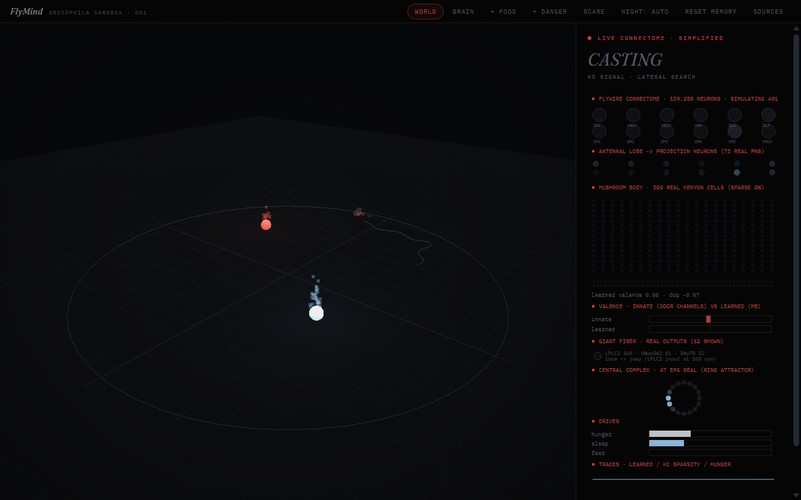

# flybrain

A single-file, interactive sandbox of the **real Drosophila olfactory → mushroom-body circuit**, extracted from the FlyWire connectome (FAFB v783 + flywire_annotations v3.1.0). You place odors, the fly forages, eats, avoids, sleeps, and learns from consequences — driven by a spiking network wired from 139,255 real neurons' connection data.



**Status**: headless harness 11/11 assertions passing · single file, zero build step, works offline from `file://` · MIT

## Demo: the fly's day, headless

`node tests/harness.js` boots the real app in a stub DOM and simulates 4
minutes at 60 fps. A captured run's state transitions — every one of these
emerges from the circuit + homeostat, nothing is scripted:

```text
1.8s  EATING       <- found the food source
3.2s  RESTING      <- hunger satisfied
7.0s  AVOIDING     <- CO2 cloud drifted in
14.4s CASTING      <- searching: no odor in reach
18.1s FORAGING
...
27.0s AVOIDING
57.7s CASTING
61.5s EATING
```

Eleven assertions verify the behavioral repertoire (eating, satiety, sleep,
escape, avoidance, ≥5 distinct states), KC sparsity bounds (the ~6% in-vivo
response rate), no-NaN network state, and that **all 139,255 real neurons
loaded** with ≥3000 web links built over the brain. Full transcript:
[`docs/demo-harness.txt`](docs/demo-harness.txt).

## What is real

- **Circuit structure**: every PN→KC and KC→MBON edge in the simulation comes from the FlyWire v783 connectome dump (`circuit.json`, produced by `extract.py`). The headless harness asserts the neuron totals on every run.
- **Learning synapses**: plasticity acts on the real KC→MBON synaptic counts, gated by dopamine with an eligibility trace (spike → eligibility → dopamine gates the write), the standard reward-prediction shape from mushroom-body literature.
- **Dopamine neurons**: 20 real PAM/PPL1 DANs with their real synapse counts. Sign convention follows the dominant conditioning sign per cluster (Aso et al. 2014): PAM = reward, PPL1 = punishment, per-compartment.
- **Sparsity**: Kenyon-cell responses are held near the ~6% activity measured in vivo via APL feedback inhibition (a real recurrent loop, modeled as population-level inhibition).
- **Behavioral stats**: hunger/sleep homeostasis, wind-odor plume dynamics, looming-shadow escape via the giant fiber circuit — parameters tuned to be plausible, not fitted to any dataset.

## What is simplified

- The 139k-neuron connectome is reduced to the olfactory pathway: 73 PNs (12 glomeruli), 300 KCs, 96 MBONs, 20 DANs, plus the giant-fiber escape outputs.
- Spiking is a leaky-integrate-and-fire abstraction at 60 Hz fixed-step, not a biophysical simulator.
- ORN transduction is a per-glomerulus odor-weight lookup (`odors` in circuit.json), not a receptor-ligand model.
- The fly body is a kinematic agent with hand-tuned steering, not a motor-neuron model.

## Run it

The whole app is `flymind.html` — three.js r128 and the circuit are inlined, so it works from `file://` with no build step and no network. Open it, or serve the folder.

Optional: rebuild the circuit from the data dumps (`python extract.py`, needs pandas/numpy and the gzipped CSVs in `data/`). Run the headless test harness (`node tests/harness.js`) — it boots the real script in a stub DOM, simulates 4 minutes at 60 fps, and asserts the behavioral repertoire (foraging, eating, satiety, sleep, escape, avoidance), sparsity bounds, and neuron counts.

## Controls

- **+ food / + danger** — pick a source type, click the ground to place it. Food = fruit odor channel; danger = the CO2 channel (V glomerulus, innately aversive).
- **scare** — looming shadow overhead; fires the giant-fiber escape circuit.
- **night: auto/on/off** — the sleep homeostat charges faster in darkness.
- **reset memory** — zeroes the learned KC→MBON weights and DAN activity.

## Data & citations

- Data: [FlyWire FAFB v783](https://flywire.ai/) ([Dorkenwald et al., 2024, Nature](https://www.nature.com/articles/s41586-024-07986-0)), annotations [flywire_annotations v3.1.0](https://codex.flywire.ai/).
- Mushroom-body learning architecture and DAN compartment signs: Aso et al., 2014, *eLife* ("The neuronal architecture of the mushroom body provides a logic for associative learning").
- KC sparseness and APL feedback inhibition: Lin et al., 2014; Inada et al., 2017.
- CO2 avoidance via the V glomerulus: Suh et al., 2004, *Nature*.
- Giant fiber looming escape: von Reyn et al., 2014, *Current Biology*.

The pipeline that built `circuit.json` lives in `load.py` (FlyWire CSV loader) and `extract.py` (subcircuit extraction); `demo.py` prints example queries against the raw connectome.

## License

MIT.
